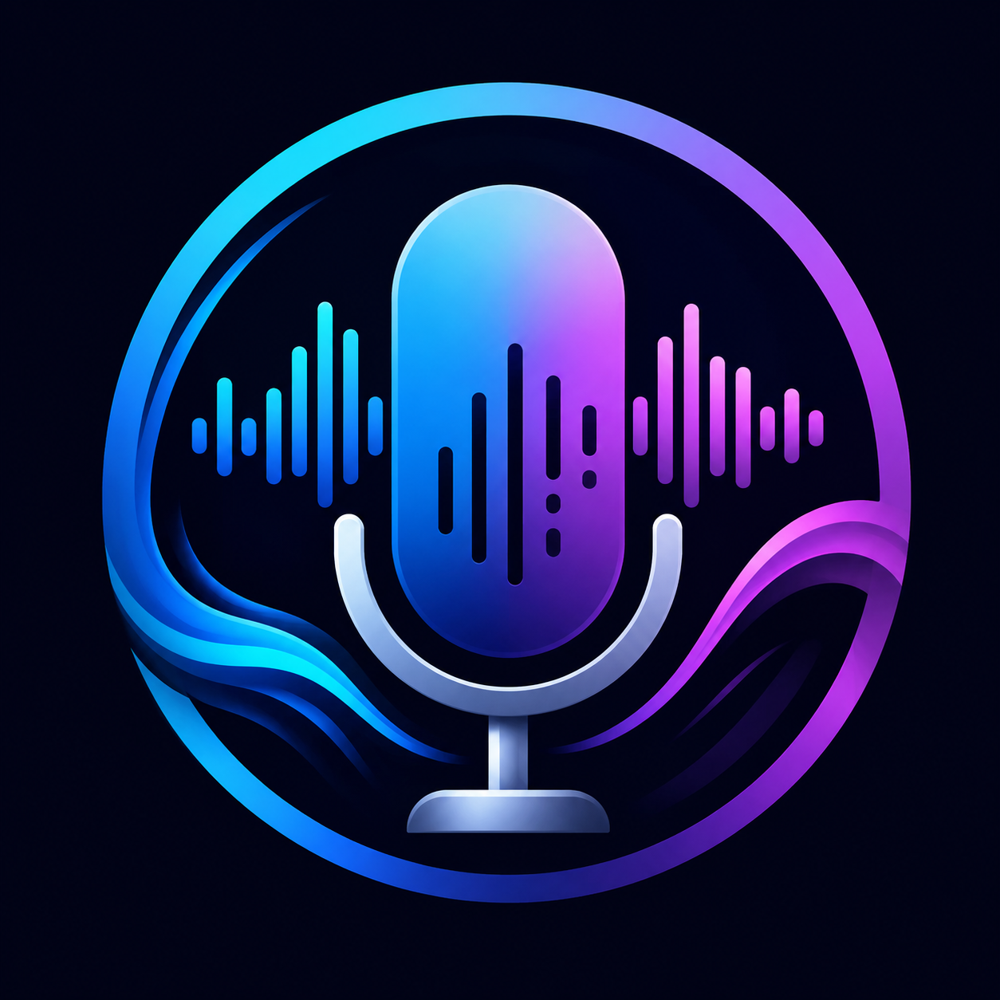

<p align="center">
  
</p>

<h1 align="center">🧠 Neural Text ↔️ Speech AI Toolkit</h1>

<p align="center">
An AI-powered web application that converts <b>text into natural-sounding speech</b> and <b>speech back into text</b>, built on Microsoft's Neural TTS and Faster Whisper.
</p>

<p align="center">
  <a href="https://text-speech-ai-toolkit.streamlit.app/"></a>
  
  
  
</p>

---

## 🚀 Live Demo

**Try the application here:**

👉 **https://text-speech-ai-toolkit.streamlit.app/**

---

## 📖 Overview

**Neural Text ↔️ Speech AI Toolkit** is an AI-powered web application that enables users to seamlessly convert **text into natural-sounding speech** and **speech back into text** through an intuitive, modern web interface.

The project combines Microsoft's Neural Text-to-Speech engine with Faster Whisper speech recognition to create a lightweight, easy-to-use AI toolkit suitable for content creators, educators, developers, and general users.

Built using **Python** and **Streamlit**, it provides a responsive interface with real-time voice generation, multilingual support, audio transcription, and downloadable outputs.

---

## 🧩 Problem Statement

Many free Text-to-Speech tools are limited by:

- Poor voice quality
- Limited language support
- No speech transcription
- Complex user interfaces
- Lack of downloadable outputs
- No integrated AI toolkit

This project solves these limitations by combining both **Text-to-Speech** and **Speech-to-Text** into a single, modern application.

---

## 🎯 Objectives

- Convert text into realistic AI-generated speech
- Support multiple languages and voices
- Allow speech speed customization
- Enable users to preview generated speech
- Download generated audio as MP3
- Convert uploaded speech into text
- Download transcribed text
- Provide a clean, responsive, single-screen interface

---

## 🚀 Features

### Text → Speech
- Multiple languages and neural voices
- Adjustable speech speed (0.5× – 2.0×)
- Character and word counters
- Estimated audio duration
- Audio preview and MP3 download
- Session-based generation history

### Speech → Text
- Upload MP3, WAV, M4A, OGG, or FLAC audio
- Fast, accurate AI transcription
- Editable transcript preview
- Downloadable `.txt` transcript

---

## 🛠️ Technology Stack

| Category | Technology |
|----------|------------|
| Programming Language | Python |
| Web Framework | Streamlit |
| Text-to-Speech | Microsoft Edge Neural TTS |
| Speech Recognition | Faster Whisper |
| Unique File Naming | UUID |
| UI Styling | HTML + CSS |
| State Management | Streamlit Session State |

---

## 🏗️ System Architecture

```
                User
                  │
                  ▼
        Streamlit Web Interface
                  │
        ┌─────────┴─────────┐
        ▼                   ▼
  Text → Speech        Speech → Text
        │                   │
        ▼                   ▼
  Edge Neural TTS     Faster Whisper
        │                   │
        ▼                   ▼
   Audio Output         Transcript
        │                   │
        └─────────┬─────────┘
                   ▼
           Download / Session History
```

---

## 📂 Project Structure

```text
text-speech-ai-toolkit/
│
├── app.py
├── styles.py
├── utils.py
├── voices.py
├── transcriber.py
│
├── assets/
│   └── logo.png
│
├── uploads/
├── generated_audio/
│
├── requirements.txt
├── packages.txt
├── README.md
├── LICENSE
└── .gitignore
```

---

## 🔄 Application Workflow

```text
Launch Application
        │
        ▼
   Choose a Tab
        │
   ┌────┴────┐
   ▼         ▼
Text →    Upload
Speech    Audio
   │         │
   ▼         ▼
Generate  Transcribe
Voice     Speech
   │         │
   ▼         ▼
 Preview   Preview
   │         │
   ▼         ▼
Download Result
```

---

## 🧠 AI Models Used

**Microsoft Edge Neural TTS** — high-quality, multilingual neural voice generation with adjustable speed.

**Faster Whisper** — fast, high-accuracy automatic speech recognition and transcription.

---

## ⚙️ Installation

### Clone the repository
```bash
git clone https://github.com/KondetiAravind/text-speech-ai-toolkit.git
cd text-speech-ai-toolkit
```

### Create a virtual environment
```bash
python -m venv venv
```

Activate it (Windows):
```bash
venv\Scripts\activate
```

Activate it (macOS/Linux):
```bash
source venv/bin/activate
```

### Install dependencies
```bash
pip install -r requirements.txt
```

### Run the application
```bash
streamlit run app.py
```

---

## 💡 Possible Applications

- Content creation and YouTube voiceovers
- Educational material narration
- Accessibility tools
- Podcast scripts and audiobook generation
- Lecture and meeting transcription

---

## 🔮 Future Scope

- Voice cloning
- Emotion-based speech generation
- Real-time speech translation
- PDF to speech
- Batch audio processing
- Speaker identification
- Cloud storage integration
- User authentication

---

## 📈 Resume Highlights

**Neural Text ↔️ Speech AI Toolkit | Python, Streamlit, Microsoft Edge TTS, Faster Whisper**

> Developed an AI-powered toolkit integrating multilingual neural Text-to-Speech and Speech-to-Text capabilities using Microsoft Edge TTS and Faster Whisper within a responsive Streamlit web application. Implemented voice customization, audio generation, transcription, session management, and downloadable outputs through a modular Python architecture.

---

## 👨‍💻 Author

**Kondeti Aravind**
Dual Degree (B.Tech + M.Tech)
Department of Computer Science & Engineering
Indian Institute of Technology Bhubaneswar

GitHub: [KondetiAravind](https://github.com/KondetiAravind)
LinkedIn: [aravind-kondeti](https://www.linkedin.com/in/aravind-kondeti)

---

## 📄 License

This project is licensed under the MIT License — see the [LICENSE](LICENSE) file for details.

---

⭐ If you found this project useful, consider giving it a star!
